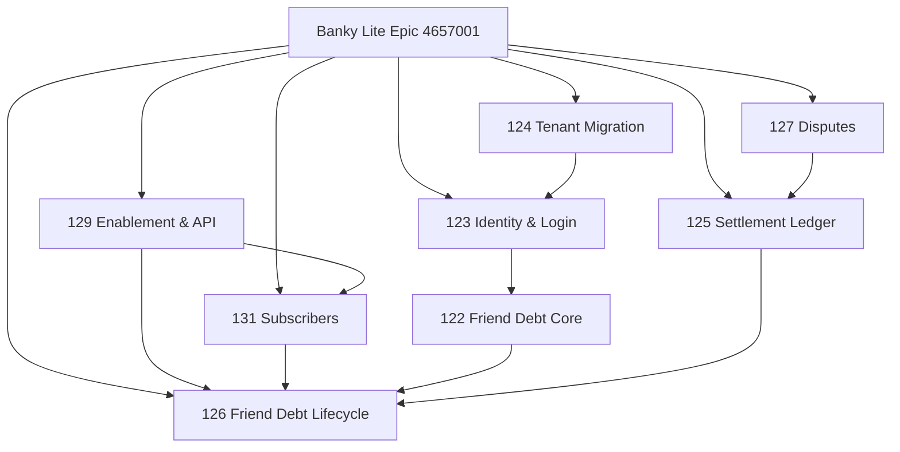

# الإيبكات والإصدارات والتبعيات — Invoicing MService

## 1. الإيبكات

| epicId | الاسم | المالك | الحالة/الملاحظة |
|---|---|---|---|
| `120216000004657001` | **بنكي لايت: الفواتير والأصدقاء والمديونية \| Banky Lite Invoicing, Friends & Debt** | Mohammed Alaqari | أُنشئ 2026-10-28، ويحتوي 8 قصص فعلية (3 Sprint10 + 5 Backlog) |
| `120216000004089726` | S:DEVOPS & ENVIROMENT | — | Epic تشغيلي/بيئي |
| `120216000002409263` | Invoice management | — | Epic قديم لإدارة الفواتير |

### نطاق Epic الجديد

- **داخل النطاق:** بنكي لايت كمزود/مستأجر، أطراف الفاتورة، المشتركون، مديونية الأصدقاء، القبول/الرفض، الدفع الجزئي، سجل المديونية، النزاعات، التسويات، الهوية المستقلة، الترحيل.
- **خارج النطاق:** ما هو موثّق في وصف Epic أو في القصص المنفصلة؛ لا تفترض أنه داخل النطاق لمجرد وجود قصة قريبة.
- **مرجع أساسي:** القصة 122 (`120216000004656142`) — وصفها الأصلي PRD كبير.

**ملاحظة:** لا تدمج Epic الجديد مع `Invoice management` أو `S:DEVOPS` إلا بموافقة صريحة لكل عنصر. دمج الإيبكات ليس مثل دمج القصص الصغيرة.

## 2. الإصدارات

| releaseId | الاسم | البداية | النهاية | الحالة |
|---|---|---|---|---|
| `120216000002911635` | `1.0` | — | 2026-03-29 | Released |

- **لا يوجد Release مفتوح.**
- **كل القصص الـ13:** `releaseCount = 0`، أي لا يوجد Release مرتبط.
- الحقل `RELEASE_ID` إلزامي في Layout، لذلك أي تحديث كامل للقصة قد يتطلب Release.
- هذا المشروع Web/Backend، وليس Mobile؛ لا تطبّق قاعدة رقم الموبايل هنا.
- قرار الإصدار التالي يحتاج تحديد: `1.1` (تحسينات متوافقة) أو `2.0` (تغيير كبير/بنكي لايت). لا تختر من عندك.

## 3. التبعيات بعد الدمج (2026-10-29)

> هذه خريطة **مقترحة** مبنية على أسماء القصص وأوصافها، وليست روابط مؤكدة في Zoho. لا تنشئ روابط قبل التحقق من `linktypeid` وموافقة المستخدم.

## 4. قراءة التبعيات

| العلاقة | المعنى |
|---|---|
| 129 → 131 | تسجيل المشتركين يعتمد على تهيئة المزود/المستأجر ونموذج الأطراف |
| 129 → 126 | دورة المديونية تحتاج API وتهيئة وأطراف فاتورة |
| 123 → 122 | مديونية الأصدقاء تحتاج هوية مستخدم مستقلة |
| 124 → 123 | ترحيل مستخدمي بنكي يعتمد على الهوية الجديدة |
| 131 → 126 | المديونية تحتاج مشتركين مسجلين |
| 122 → 126 | المتطلب التجاري/PRD هو مرجع دورة المديونية |
| 125 → 126 | دفتر التسويات يعتمد على الدفع الجزئي داخل الدورة |
| 127 → 125 | النزاعات تؤثر في التسويات |

**السجلات المدمجة:** 128 + 132 داخل 129، و130 + 133 + 134 داخل 126. لا تُعامل كقصص مستقلة في التخطيط.

## 5. فجوات يجب حسمها

1. **Release:** لا يوجد إصدار مفتوح ولا ربط. اختر `1.1` أو `2.0` ثم اربط القصص.
2. **الوصف القديم:** 123/124/125/127 تحتوي ملاحظة قديمة بأن UDFs غير قابلة للكتابة. الحقول أصبحت مكتوبة، لكن النص القديم بقي حسب القاعدة.
3. **Epic vs Story:** 122 كبيرة جداً (PRD 18.5k). قد تكون Epic فرعياً أو Story مرجعية؛ لا تدمجها آلياً.
4. **Backend Feature type:** لا يوجد خيار Backend في `UDF_RADIO1`، لذلك 124/128/129/130/133 بلا Feature type.
5. **دمج القصص:** تم تنفيذ الدمج في 2026-10-29: 8 قصص بنقطة واحدة → 3 قصص (126/129/131)، ونُقلت السجلات المدمجة إلى Backlog. التفاصيل في `OPEN-STORIES_AR.md` و`MERGE-EXECUTION-REPORT_AR.md`.

## 6. الترتيب المقترح للتنفيذ

1. **123** الهوية المستقلة (إن لم تكن جاهزة، 122 سيتعطل).
2. **129** تمكين Banky Lite: التكامل والتهيئة وأطراف الفاتورة.
3. **131** المشتركون وتسجيل الأصدقاء.
4. **122** نواة مديونية الأصدقاء (مرجع/PRD).
5. **126** دورة حياة مديونية الأصدقاء كاملة.
6. **125 + 127** التسويات والنزاعات.
7. **124** الترحيل.

هذا ترتيب منطقي مقترح، وليس خطة معتمدة. راجعه مع الفريق قبل Sprint Planning.
