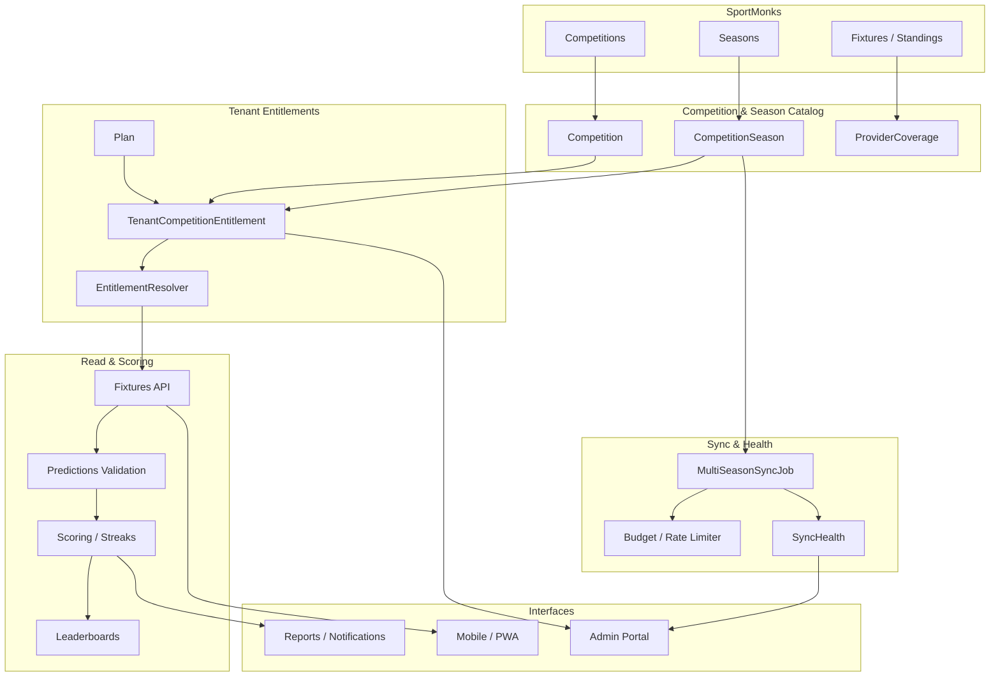
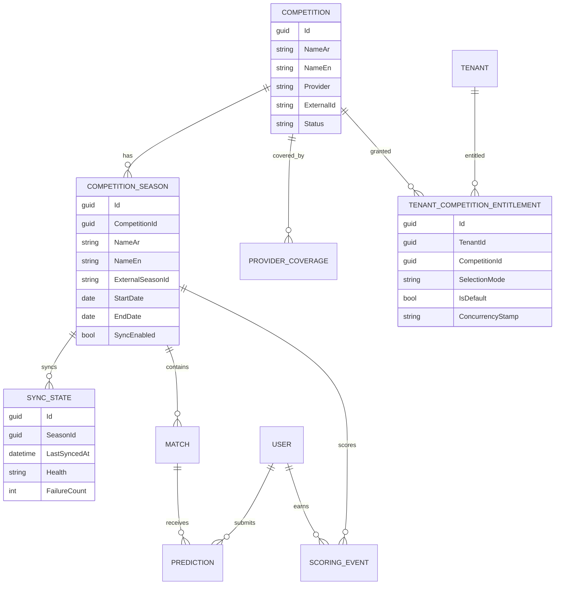
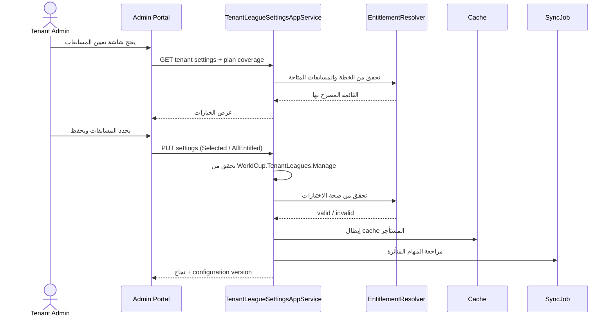
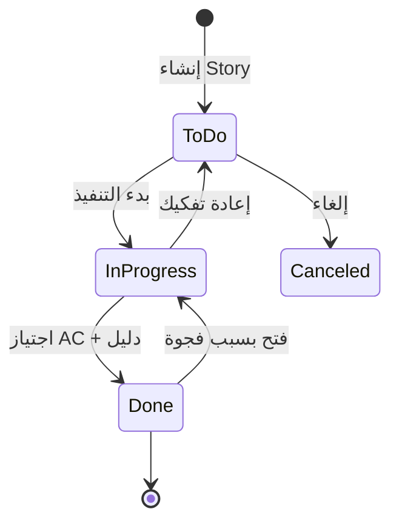
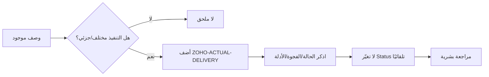

# مراجع ومخططات مشروع World Cup

**الغرض:** تجميع المراجع الفنية والمخططات التي تدعم قصص Multi Competition، لأن MCP الحالي لا يدعم إرفاق الملفات بالقصص.
**تاريخ:** 2026-10-28.

> **قيد:** لا توجد أداة attachment في Zoho Sprints MCP (83 أداة). `AddItemComment` لا يقبل ملفات. لذلك أُنشئت هذه الملفات المحلية كمرجع، وتم توثيق القصص التي تحتاج مراجعة، دون ادّعاء إرفاقها في Zoho.

---

## 1. خريطة التتبع Stories ↔ BMAD ↔ Git

| Story | BMAD artifact | Git / كود | حالة التغطية |
|---|---|---|---|
| SNA-116 Competition and Season Catalog | `10-1-league-season-catalog-schema-migration.md` | `1030f85e`, `71df6def`, `289d044c`; SportMonksOptions | مرتبط/جزئي — الآلية الفعلية تختلف عن Competition/CompetitionSeason |
| SNA-117 Historical Data Migration | `10-1-league-season-catalog-schema-migration.md`, `10-1-league-backfill-manifest.json` | نفس 10.1 | مرتبط |
| SNA-118 Multi Season Data Synchronization | `10-2-multi-season-sync-job-loop.md` | `28587083`, `01591175`; MatchDataSyncJob.cs | مرتبط |
| SNA-119 Shared Provider Budget and Sync Health | `10-2-multi-season-sync-job-loop.md` | MatchDataSyncJob.cs, SportMonksOptions.cs | مرتبط |
| SNA-120 Tenant Competition Entitlements | `10-3-tenant-league-assignment-admin-api-settings.md` | `a81f9e40`, `50565d34`; TenantLeagueService.cs, TenantLeagueSettingsAppService | مرتبط — تعارض دلالة الاختيار الفارغ |
| SNA-121 Competition Aware Reads | `10-5-fixture-list-api-league-filter-dto.md` | `7d251dec`, `026d2741`; FixtureAppService, AdminFixtureAppService, LeaderboardAppService | مرتبط |
| SNA-122 Season Scoring Streaks and Leaderboards | `4-3-streak-multiplier-application.md`, `4-10-final-scoring-and-dense-leaderboard-remediation.md` | لا يوجد 10.x مخصص | مرتبط موضوعيًا |
| SNA-123 League Cup and Stage Formats | لا يوجد artifact مخصص | لا يوجد دليل مباشر | غير مغطى |
| SNA-124 Season Context Notifications and Sharing | `10-6` مذكور في sprint-status/epics؛ لا ملف artifact | لا يوجد دليل مباشر | غير مغطى |
| SNA-125 Competition Reports Cache | لا يوجد artifact مخصص | لا يوجد دليل مباشر | غير مغطى |
| SNA-126 Admin Competition and Season Management | `10-4-admin-league-catalog-tenant-assignment-ui.md` | `4546b679`, `5dd2c6a3`; LeagueCatalog | مرتبط |
| SNA-127 Admin Tenant Competition Assignment | `10-4-admin-league-catalog-tenant-assignment-ui.md` | نفس 10.4؛ TenantLeagueAssignment, DowngradeWarningModal | مرتبط |
| SNA-128 Admin Match Operations and Reports | لا يوجد artifact مخصص | لا يوجد دليل مباشر | غير مغطى |
| SNA-129 Admin Multi Season Sync Monitoring | `10-2` / `10-4` (مرتبط) | MatchDataSyncJob + Admin UI | غير مؤكد |
| SNA-130 Player Competition and Season Navigation | `10-6` (sprint-status/epics) | لا يوجد artifact منفصل | غير مغطى |
| SNA-131 Player Fixtures Prediction and Standings | `10-6` | لا يوجد artifact منفصل | غير مغطى |
| SNA-132 Player Predictions Season and Friends Rankings | `10-6` | لا يوجد artifact منفصل | غير مغطى |
| SNA-133 Player Links Localization and PWA Cache | `10-6` | لا يوجد artifact منفصل | غير مغطى |
| SNA-53 wc-app Angular PWA shell | `9-1-enduser-angular-pwa-scaffold.md` | `b9831d66`, `a653e56d`, `a6a3d0c8`, `86551da7` | الكود موجود، الحالة To do |
| SNA-141 Fixture List API — League Filter | `10-5-fixture-list-api-league-filter-dto.md` | `7d251dec`, `026d2741` | Task مكتملة، ملحق تسليم مضاف |
| SNA-142 Admin tenant leagues UI | `10-4-admin-league-catalog-tenant-assignment-ui.md` | `4546b679`, `5dd2c6a3` | Task مكتملة، ملحق تسليم مضاف |

**دلالة:** «مرتبط» = يوجد artifact/كود له صلة واضحة. «غير مغطى» = لم يُعثر على artifact/كود مطابق، وليس بالضرورة عدم وجود تنفيذ. لا تحوّل هذا الجدول إلى ادعاء اكتمال.

---

## 2. مخطط العمارة المفاهيمي

---

## 3. مخطط ER مبسط

---

## 4. مخطط تسلسل: تعيين مسابقة لمستأجر

---

## 5. مخطط حالة القصة

**ملاحظة:** لا تنتقل إلى Done لمجرد وجود commit. الانتقال يتطلب دليل قبول (اختبار/UAT/مراجعة). إن لم يوجد، ابقِ الحالة ووثّق `unverified`.

---

## 6. مخطط دورة الملحق

---

## 7. المراجع المحلية

- `reports/WorldCup-New/2026-10-28/REVIEW-BEFORE-ZOHO-EXECUTION_AR.md`
- `reports/WorldCup-New/2026-10-28/FIELDS-AND-ACTUAL-DELIVERY_AR.md`
- `reports/WorldCup-New/2026-10-28/proposed-description-SNA-141.md`
- `reports/WorldCup-New/2026-10-28/proposed-description-SNA-142.md`
- `reports/WorldCup-New/2026-10-28/readback-116-133.out.json`
- `reports/WorldCup-New/2026-10-28/readback-summary.json`
- `reports/WorldCup-New/2026-10-28/knowledge/USER-STORIES-CATALOG_AR.md`
- `reports/WorldCup-New/2026-10-28/knowledge/MOHAMED-AQARI-WORK-MECHANISM_AR.md`
- `reports/WorldCup-New/2026-10-28/knowledge/HOW-TO-WRITE-USER-STORIES_AR.md`

### مراجع BMAD

- `_bmad-output/implementation-artifacts/10-1-league-season-catalog-schema-migration.md`
- `_bmad-output/implementation-artifacts/10-1-league-backfill-manifest.json`
- `_bmad-output/implementation-artifacts/10-2-multi-season-sync-job-loop.md`
- `_bmad-output/implementation-artifacts/10-3-tenant-league-assignment-admin-api-settings.md`
- `_bmad-output/implementation-artifacts/10-4-admin-league-catalog-tenant-assignment-ui.md`
- `_bmad-output/implementation-artifacts/10-5-fixture-list-api-league-filter-dto.md`
- `_bmad-output/implementation-artifacts/9-1-enduser-angular-pwa-scaffold.md`

### مراجع الكود

- `FixtureAppService.cs`
- `AdminFixtureAppService.Extended.cs`
- `LeaderboardAppService.cs`
- `GetAdminFixturesInput.cs`
- `TenantLeagueService.cs`
- `TenantLeagueSettingsAppService`
- `LeagueCatalog`
- `TenantLeagueAssignment`
- `DowngradeWarningModal`
- `MatchDataSyncJob.cs`
- `SportMonksOptions.cs`

---

## 8. ما لا يمكن فعله عبر MCP الحالي

| القدرة | الحالة |
|---|---|
| إرفاق ملف/صورة بقصة | غير مدعوم |
| كتابة حقول UDF | مدعومة فعليًا عبر `UpdateItem` رغم أن schema لا يعلنها |
| تعديل عنصر في سبرنت مكتمل | مرفوض `7401.14` |
| قراءة تعريف الحقول | غير مباشرة؛ `getCustomLayouts` يعيد layouts فقط، و`formfields.json` استُخدم كمرجع |
| إضافة تعليق | مدعومة نصيًا فقط |
| إنشاء Release | مدعومة |
| ربط Release بعناصر | مدعومة عبر `AssociateItemsWithRelease` |
| ربط عناصر ببعضها | `LinkItems` موجود، لكن `GetLinkedItems` أعاد خطأ داخليًا في SNA-116 |
